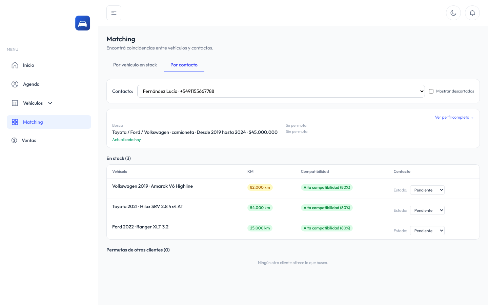
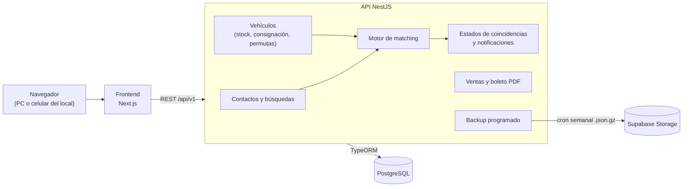
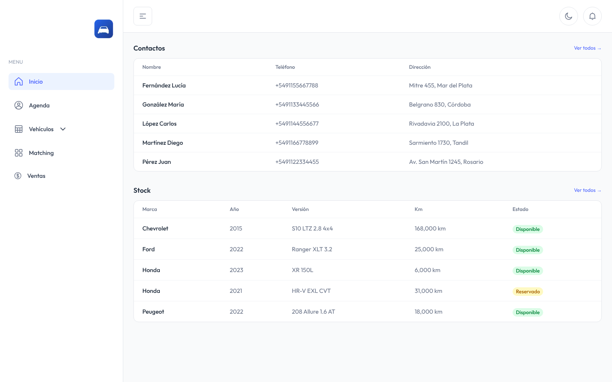
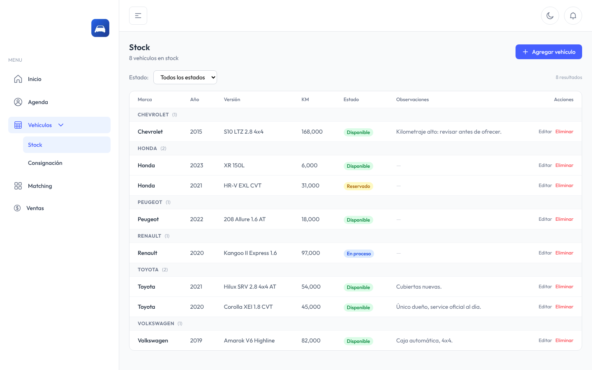
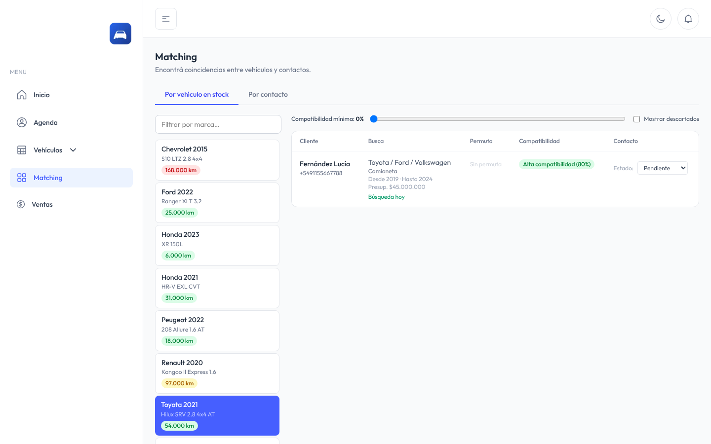
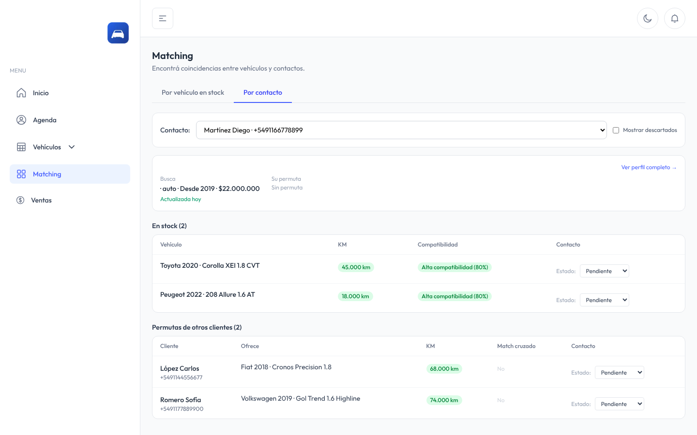

# Sistema de Gestión para Concesionarias

Sistema web para concesionarias de autos usados. Cruza automáticamente lo que busca cada cliente con el stock que va entrando, lleva el seguimiento de cada contacto comercial y genera el boleto de compraventa en PDF.

Es la versión genérica y configurable de un sistema que desarrollé para una concesionaria y que hoy está en producción. El nombre, el logo y los datos del vendedor se configuran en cada instalación por variables de entorno, sin tocar el código.

> Repositorio vitrina: descripción, arquitectura y capturas. El código fuente es privado.

## El problema

En una concesionaria chica o mediana, los pedidos de los clientes ("busco una camioneta Toyota o Ford, 2019 en adelante, hasta tantos millones") se anotan en un cuaderno o en el WhatsApp del vendedor. Cuando entra un vehículo que le sirve a alguien, depende de que el vendedor se acuerde. Muchas ventas se pierden así.

El sistema guarda cada búsqueda de forma estructurada y, cada vez que entra un vehículo (al stock, en consignación o como permuta), avisa a quién le puede interesar.

## Funcionalidades

**Motor de coincidencias con tres escenarios**

1. **Vehículo → clientes.** Cuando entra un vehículo al stock, el sistema lista los clientes cuya búsqueda coincide, ordenados por compatibilidad.
2. **Cliente → stock.** Cuando se carga un cliente nuevo o se actualiza su búsqueda, muestra qué hay en stock para él.
3. **Cadena de permutas.** Detecta cuándo el vehículo que ofrece un cliente como parte de pago le sirve a otro cliente, y marca el *match cruzado* cuando además la permuta del segundo le sirve al primero.

**Filtros jerárquicos del matching:** primero la categoría (auto, SUV, camioneta, utilitario, moto), después la marca o el listado de marcas aceptadas, después la versión y por último año y presupuesto. Una búsqueda puede ser solo por categoría ("cualquier auto 2019 en adelante"). Cada coincidencia tiene un puntaje de compatibilidad (marca, año, categoría, presupuesto).

**Seguimiento de cada coincidencia:** cada par cliente–vehículo tiene un estado (pendiente, contactado, no contesta, descartado, concretado) con nota. Las descartadas se ocultan salvo que se pidan.

**Alertas por kilometraje:** el km de cada vehículo se marca en verde (< 80.000), amarillo (80.000–149.999) o rojo (≥ 150.000).

**Antigüedad de la búsqueda:** indica si una búsqueda está "fresca" o conviene reconfirmarla antes de llamar al cliente.

**Notificaciones** en el encabezado cuando aparece una coincidencia nueva o una cadena de permutas.

**Ventas y boleto de compraventa:** registro de ventas con una o varias permutas, efectivo, cheques y financiación en cuotas. Genera el boleto en PDF y permite adjuntar el comprobante. Las ventas se anulan con *soft delete* y los vehículos vuelven al estado anterior sin perder las permutas.

**Stock, consignaciones y agenda de contactos**, agrupados por marca y apellido.

**Backup semanal automático** de la base comprimido (`.json.gz`) a Supabase Storage, con retención configurable y script de restauración.

## Stack

| Capa | Tecnologías |
| --- | --- |
| Frontend | Next.js 16 (App Router), React 19, TypeScript, Tailwind CSS 4 |
| Backend | NestJS 10, TypeScript, TypeORM, class-validator, @nestjs/schedule |
| Base de datos | PostgreSQL 16 (migraciones TypeORM) |
| Documentos | pdfmake (boleto de compraventa) |
| Backups | Supabase Storage + cron semanal |
| Despliegue | PM2 en una PC del local (Windows o Linux) o en la nube |

## Arquitectura

El matching se recalcula al crear o editar un vehículo o una búsqueda, y las coincidencias nuevas generan notificaciones. ([diagrama en PNG](docs/arquitectura.png))

## Modalidades de instalación

**Local (recomendada para un solo local):** PostgreSQL, backend y frontend corren en una PC del local, con Windows o Linux, y se manejan con PM2. Los demás equipos y celulares de la red entran por el navegador. Los datos quedan en el local y el backup semanal sale a la nube.

**Nube:** el backend en cualquier hosting Node, el frontend en Vercel o similar y PostgreSQL gestionado (Supabase, Neon, RDS).

## Capturas

Todas con datos ficticios.

| | |
| --- | --- |
|  |  |
| **Inicio:** últimos contactos y stock | **Stock** agrupado por marca, con estados y alertas de km |
|  |  |
| **Vehículo → clientes**, con compatibilidad y estado del contacto | **Cliente → stock** y permutas de otros clientes que le sirven |

## Descripción técnica

- **Backend modular en NestJS:** un módulo por dominio (contactos, vehículos, matching, estados de coincidencia, notificaciones, ventas, backup), cada uno con controller, service, repositorio y DTOs validados con `class-validator`. Las respuestas y los errores pasan por un interceptor y un filtro globales para que el formato sea siempre el mismo.
- **Motor de matching:** el prefiltro por rango de años se hace en SQL con QueryBuilder y los filtros jerárquicos (categoría → marcas aceptadas → versión) en TypeScript. El puntaje pondera marca, año, categoría y presupuesto. En el matching directo, los estados de cada par cliente–vehículo se cargan en una sola consulta (sin N+1).
- **Modelo de datos:** una sola entidad `Vehiculo` con tipo (`stock`, `permuta`, `busqueda`) permite usar la misma lógica para lo que hay y lo que se busca. Las ventas tienen relación uno a muchos con las permutas, *soft delete* y reversión de estados al anular.
- **Migraciones TypeORM idempotentes** para actualizar instalaciones en producción sin perder datos. `synchronize` queda activo solo en desarrollo.
- **Boleto de compraventa** generado en el servidor con pdfmake: cheques, financiación en cuotas con interés simple y tabla de permutas con datos registrales.
- **Backups:** tarea programada con `@nestjs/schedule` que exporta la base, la comprime con gzip, la sube a Supabase Storage, rota las copias viejas y trae un script de restauración.
- **Configuración por instalación:** marca, logo y datos del vendedor por variables de entorno, sin tocar el código, para venderlo como producto a más de una concesionaria.
- **Tests de integración** de los controllers con Jest y Supertest.

## Código fuente

Este repositorio es una vitrina: el sistema se comercializa como producto, así que el código está en un repositorio privado. Si querés ver una demo en vivo o revisar el código en una entrevista técnica, escribime.

## Autor

© 2026 Matías Scavuzzo. Todos los derechos reservados.

Matías Scavuzzo — [github.com/MatiScavuzzo](https://github.com/MatiScavuzzo)
